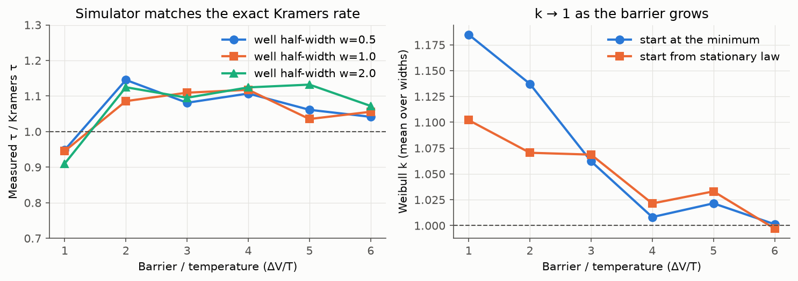
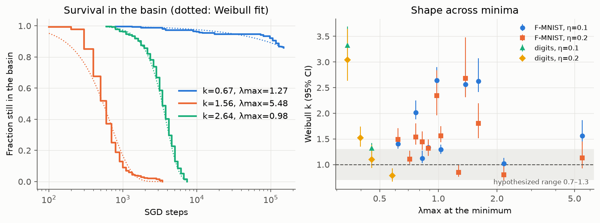
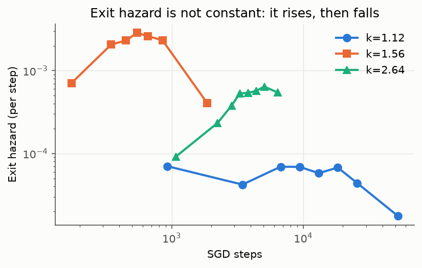
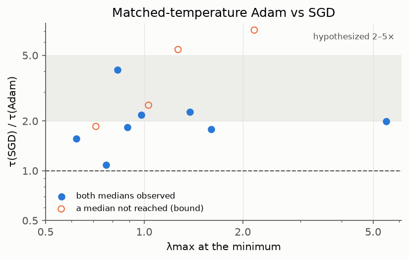
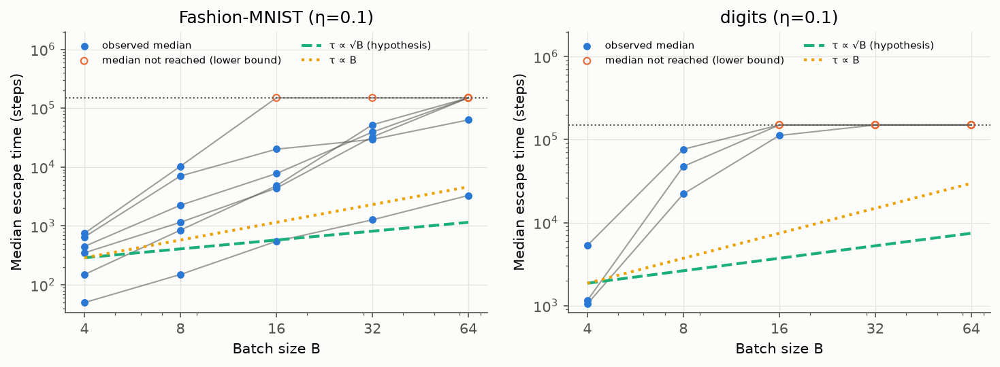
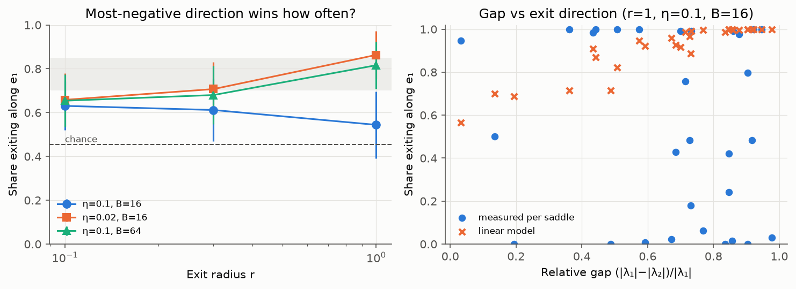

# Escape Time Distributions in SGD: Measuring How Long Optimizers Stay Trapped in Loss Basins

## 1. Executive Summary

We asked whether escape from loss basins follows the specific numerical laws in the hypothesis. We ran real SGD and Adam from exact
polished minima and true saddles of small tanh networks on Fashion-MNIST and digits. Basin exit was decided by converged quenching. The data cover
165 conditions, 23,104 replicas, 17,474 audited exits and 30 saddles, and the simulator reproduced the exact Kramers rate on a controlled double well
(median measured/exact τ = 1.07 at high barrier).

**None of the four numerical claims held as stated, but each was wrong in an informative way.**

| Claim | Verdict | Key measurement |
|---|---|---|
| Weibull, not exponential | **Partly.** Exponential is rejected, but Weibull is not singled out | LRT significant in 86% of conditions; Weibull best by AIC in 4 of 28 |
| k between 0.7 and 1.3 | **Refuted** | Only 32% in range (median 1.47, max 3.33) |
| k depends on basin geometry | **Refuted** | ρ(k, log λmax) = −0.06, p = .77 |
| Adam 2–5× faster at narrow basins | **Partly.** Point estimate in range, CI wider | 2.75× [1.89, 5.18] |
| Adam similar at wide basins | **Refuted** | 1.89× [1.24, 3.22]; no significant narrow/wide difference |
| Doubling B multiplies τ by √2 | **Refuted** | ×5.1 [3.4, 8.0]; slope 2.02 [1.64, 2.41], against 0.5 |
| η/B controls temperature | **Supported on Fashion-MNIST**, only partly on digits | τ·η ratio 1.05 [0.87, 1.38] and 0.94 [0.72, 1.10] |
| Top eigenvector predicts exit, 70–85% | **Noise-dependent** | 54% at high noise, 82–86% at low noise (r=1) |
| The eigenvalue gap predicts accuracy | **Refuted** | ρ between −0.07 and +0.23, all n.s. |

Three findings go beyond the hypothesis:
1. k≠1 mostly reflects **a start-up delay (k>1) and mixing across minima (k<1)**, not a shape law. Left-truncation moves the median k from
   1.47 to 1.03, and pooling minima pushes it down to 0.52–0.74.
2. The Adam result **reverses with calibration**. Adam is about 2× faster at matched in-basin loss, while default-LR Adam produced no escapes at
   all in 150,000 steps at 5 of 5 tested minima.
3. Saddle exit direction is **highly reproducible even when it isn't e₁** (modal share 88–94% at r=1). Something beyond the linearized model is steering it.

**Practical implications.** Use η/B as the control variable, and expect a steep response: batch size has far more leverage on trapping than a
√B law suggests. Do not read Adam-vs-SGD escape claims without the LR calibration. Sharpness (λmax) did not predict escape time here (ρ = 0.08).

## 2. Research Question & Motivation

**Hypothesis under test.** (H1) Escape times are Weibull, not exponential, with k in 0.7–1.3 depending on geometry. (H2) Adam escapes narrow basins 2–5×
faster than SGD, with similar times at wide basins. (H3) Doubling B at fixed η multiplies mean escape time by √2, with the B/η ratio setting temperature.
(H4) Hessian eigenvalue gaps at saddles predict escape direction with 70–85% accuracy.

**Why it matters.** Flat-minima and generalization arguments lean on mean escape-time formulas derived in asymptotic limits. The distribution says whether
escape is memoryless, which is what those SDE arguments assume.

**Gap.** Prior work measures mean rates. We found no study of distribution shape with censoring and model comparison in real networks, and arXiv keyword
searches found none (not proof of absence). Theory also disagrees on Adam's direction (§3).

## 3. Literature Review Summary

Full version in `literature_review.md`.
- **Kramers (1940):** high-barrier escape is Poisson, so times are exponential (k=1).
- **Xie et al. 2021; Mori et al. 2022:** log τ is linear in B/η. Mori's rate is a power law in L(θ_s)/L(θ*), not in B. **No theory reviewed predicts τ ∝ √B**,
  which would be a substantive new claim.
- **Smith & Le 2018; Jastrzębski et al. 2018:** temperature scales as η/B.
- **Zhou et al. 2020:** SGD escapes sharp minima faster than Adam, contrary to H2.
- **Xie et al. 2022:** adaptive LR speeds saddle escape, momentum does not help minima selection.

## 4. Methodology

### 4.1 Setup
- **Models:** one-hidden-layer tanh MLP, cross entropy + L2. Tanh gives exact Hessians. L2 and underparameterization give strict minima with nonzero per-sample gradients.
- **Landscapes.** A (main): Fashion-MNIST, 2,000 examples, 24 PCA dims, h=8, wd=1e-4, 290 parameters; λmax 0.62–5.48. B (replication): digits (UCI optdigits),
  1,797 examples, h=8, wd=1e-3, 610 parameters; λmax 0.34–0.58 only, so narrow/wide contrast there is weak. S (saddles): as A with h=3, 115 parameters.
- **Minima:** 12 (A) and 6 (B), chosen evenly in λmax rank before any escape measurement, Newton-polished in float64 (‖g‖<1e-7, H positive definite).
- **Optimizers:** SGD; Adam (β 0.9, 0.999); ablations RMSProp, SGD+momentum (β=0.9, lr=0.01, same effective η), warm-started Adam. Fixed-size minibatches
  sampled per replica. R=256 at the base condition, otherwise 128 (64 for default Adam). Run cap 150,000 steps.
- **Compute:** shared 4× RTX A6000 (48 GB, heavily contended; 1–3 GB slices), ~29 worker-hours, float32 simulation. CPU for E0, Hessians, E4. Python 3.12, PyTorch 2.15, NumPy 2.5,
  SciPy 1.18, pandas 2.3. Batch sizes are the experimental variable, not tuned to memory. No LLM was involved and no API cost was incurred.

### 4.2 Escape definition
At checks spaced by 10% (minimum gap 100 steps), each replica's parameters are copied and relaxed by full-batch heavy-ball descent. A replica has exited if the relaxed
point converges to a different minimum: 1,500·max(1,λmax) steps gate, >0.3 from θ* triggers 5,000·max(1,λmax) steps, then distance >0.05 **and** either a segment barrier >1e-5
or |ΔL|>2e-5. Times are interval-censored between checks.

This definition survived two failures, both found by testing it:
- **Short quenches were misleading.** A 400-step quench reported 0–34% exited where a converged quench reported up to 97%, which made escape look sharply timed. Converged quenches showed the
  truth: replicas fall back to exactly θ* or onto a discrete neighbouring minimum.
- **Slow soft modes gave false exits.** A Newton audit found that 495 of the first 6,337 exits (7.8%) polished back to θ*. The barrier/loss rule was added, and affected runs were repeated with the same seeds.
  In one minimum, 71% of exits had been false. "No barrier" alone would have been wrong, because digits s3_p1 has a real neighbour with no segment barrier.

### 4.3 Experiments
- **E0, controlled double well** (8-dim, Gaussian minibatch-noise limit, 1,000 replicas): validation against Kramers, plus transient, loss-proportional-noise and Adam variants. It validates the instrument and is not a model of a network.
- **E1, distribution shape:** all minima, SGD, B=16, η=0.1 and 0.2.
- **E2, Adam vs SGD:** Adam at lr ∈ {0.004, 0.008, 0.016} (A) and {0.001, 0.002} (B). Median interpolated in log lr to the per-minimum matched LR, where matched means equal mean excess full loss over steps 500–2,000 (well before most exits).
  Matched lr: 0.0055–0.0109 (A), 0.00135–0.00152 (B). Wide/narrow = bottom/top third by λmax (n=4 each on A).
- **E3, batch and ratio:** 6 (A) and 3 (B) minima, B ∈ {4,8,16,32,64} at η=0.1, plus equal-ratio triple (0.05,8), (0.1,16), (0.2,32).
- **E4, saddles:** 30 unique saddles (mode-following Newton, ‖g‖<1e-9; mostly index 2; chance averages 0.456), R=128, (η,B) ∈ {(0.1,16), (0.02,16), (0.1,64)}. Winner: largest |projection| on the negative eigenvectors at first crossing of radius r in that subspace.
  Baselines: chance, and a linearized Monte-Carlo model with measured per-sample noise covariance.

### 4.4 Statistics
Interval-censored MLE for exponential, Weibull, gamma, lognormal and shifted-exponential models (recovery check: k_true 0.7/1.0/1.3 gave 0.71/1.03/1.29, with 5% false rejection of k=1). BH-FDR on LRTs. k CIs: 100-replicate replica bootstrap.
Cross-minimum CIs: bootstrap over **minima**, the unit of generalization. τ is the Kaplan–Meier median. When it is not reached, τ is held at the 150,000-step lower bound and flagged (Weibull extrapolations reached 1e9) and excluded from slope and factor fits.
H1 analyses use conditions with ≥50% exits (28 of 36 E1 conditions). Bars in figures: 95% CI.

## 5. Results

### 5.1 Validation (Figure 1)
At Δ/T ≥ 4, measured τ / Kramers τ = 1.03–1.13 (median 1.07) across three well widths, about two orders of magnitude of τ. k fell from 1.19 (Δ/T=1, start at minimum) to 1.00 (Δ/T=6). A near-stationary start gave 1.10 at Δ/T=1: part of the low-barrier excess is not start-up delay.

### 5.2 What escape looks like
Exits are discrete hops. In typical conditions a replica lands on one of a few specific neighbours, usually at lower loss (median 89% of exits per condition) and over a barrier (median 100%). The top destination takes a median of 88% of a condition's exits (median 3 distinct destinations by loss). τ across minima at the same (η,B) spans 550 to >150,000 steps.

**Audit.** A sample of 192 accepted exits Newton-polished in float64: 100% strict minima, 98.4% distinct from θ* (3 fell back; residual false-exit rate 1.6%, Wilson CI 0.5–4.5%). A same-seed GPU rerun of one condition reproduced every replica's exit check exactly.

### 5.3 H1: distribution shape (Figure 2, Figure 3)
| Statistic (28 conditions) | Value | Criterion | Met? |
|---|---|---|---|
| LRT k=1 rejected, FDR 5% | 86% | majority | Yes |
| ΔAIC(Weibull−exponential) < −10 | 75% | majority | Yes |
| k within 0.7–1.3 | 32% | ≥90% | **No** |
| k < 1 / k > 1.3 | 11% / 68% | both present | Yes |
| k range (median) | 0.79–3.33 (1.47) | | |
| Spearman k vs log λmax / log trace / log det | −0.06 / −0.08 / −0.20 | p<.05 | **No** (p=.77/.68/.31) |

Best AIC model: lognormal 13, gamma 8, Weibull 4, shifted exponential 3. Differences among two-parameter models are small: the median Weibull AIC gap to gamma is 2.1 and to lognormal 0.1, and Weibull beats shifted exponential by a median 4.9. So Weibull describes the data about as well as its rivals, but **the data do not single it out**.
Adam shows the same pattern: median k=1.50 on A, 22% in range. Excluding the 8 conditions with <50% exits removes minima that barely escape, so tail behaviour there is unobserved.

**Why k≠1 (the decomposition).**
- **Delay.** Discarding the first 25% of exits and refitting residual time (left truncation): median k = **1.03** (IQR 0.90–1.20; 50% within 0.85–1.15, against 18% before truncation). At 50%: 1.05.
- **Heterogeneity.** Pooling minima: k = 0.74 and 0.59 on A, 0.52 and 0.57 on B, against within-minimum means of 1.76, 1.51, 2.32, 1.61. Pooling alone flips the sign of k−1.
- **Not fully memoryless.** Hazards rise and then fall late (Figure 3), and residual k still reaches 0.74–1.79. A constant-hazard-after-delay model is an approximation.

### 5.4 H2: Adam vs SGD (Figure 4)
| Group, Fashion-MNIST | τ(SGD)/τ(Adam), matched in-basin loss | 95% CI |
|---|---|---|
| Narrow (top third by λmax) | **2.75** | 1.89–5.18 |
| Wide (bottom third) | **1.89** | 1.24–3.22 |
| Narrow/wide ratio | 1.46 | 0.74–3.09 |
| All 12 minima | 2.42 | 1.83–3.27 |
| Minima with both medians observed (n=8) | 1.97 | 1.56–2.53 |

Spearman of ratio vs log λmax: 0.47 (p=.12). So Adam is about twice as fast across the board at matched loss, with **no demonstrated dependence on basin width** (n=12 is low-powered, so a moderate effect isn't excluded). H2a's CI is not inside [2,5]. H2b fails: wide ratio >1.5 and its CI excludes 1. H2c isn't significant.

**Digits:** 1.56× [0.90, 3.22], with 5 of 6 minima involving a censored median, so this is weak evidence.

**Ablations (6 minima, τ relative to SGD η=0.1):**
| Variant | τ / τ_SGD | Reading |
|---|---|---|
| RMSProp, lr 0.008 (no momentum) | 0.41 [0.25, 0.63] | Reproduces Adam's speed-up: **the adaptive scaling is the source** |
| Adam warm-started, lr 0.008 | 0.35 [0.22, 0.53] | Not a cold-start artefact |
| SGD+momentum, same effective η | 1.00 | Same median check at all 6 minima (resolution ~10%; one minimum censored in both) |
| **Adam default lr 0.001** (5 minima) | No exits at all | At least 7–34× slower at the 4 minima where SGD's median was observed; **reverses the direction** |

In the double well (E0), with theory-matched Adam, τ_SGD/τ_Adam was 0.68–0.80 in narrow wells and 0.87–1.27 in wide wells. Adam was not faster there, even with curvature-aligned noise. So the network speed-up is not a generic property of adaptive scaling on a single barrier. Its cause in networks was not tested.

### 5.5 H3: batch size and temperature (Figure 5)
| Measure | Fashion-MNIST (6 minima) | Digits (3 minima) | Hypothesis |
|---|---|---|---|
| Slope of log₂τ on log₂B | **2.02 [1.64, 2.41]** (per-minimum 1.5–2.8) | 3.4 (one minimum) | 0.5 |
| τ factor per doubling | **5.1 [3.4, 8.0]** | 18 [10, 41] | 1.41 |
| By step, B 4→8 / 8→16 / 16→32 / 32→64 | 5.9 / 3.8 / 4.2 / 2.4 | 23 / 5.1 / censored | constant |
| AIC power law vs Arrhenius (lower is better) | −16.7 vs +16.1 | −2.9 vs +6.4 | power preferred |

The √2 claim is rejected decisively. Its one structural prediction, H3b, did hold: within the observed range, a power law in B fits better than log τ linear in B. Caution: this comparison uses uncensored medians only, and Arrhenius predicts the fastest growth at large B, exactly where censoring removes data; the falling step factors could also reflect only fast minima surviving. So the data favour a power law **over B = 4–32**, and do not rule out Arrhenius behaviour in general. In E0, a single barrier, log τ was linear in 1/T even with loss-proportional noise, so the network law is not explained by that noise alone.

**Equal η/B (H3c).** Fashion-MNIST: τ·η is invariant, ratios 1.05 [0.87, 1.38] for (0.2,32)/(0.1,16) and 0.94 [0.72, 1.10] for (0.05,8)/(0.1,16). In raw steps the same runs differ by 2×, so SDE time is the right clock. Doubling η at fixed B cut τ 9.4× [7.0, 13.4], matching about 2× time rescaling times 5× temperature. Digits are weaker: 1.28 [1.02, 2.00] and 0.55 [0.50, 0.67], on 3 minima with few exits. The η/B law therefore holds well on the main landscape and only roughly on digits.

### 5.6 H4: saddle exit direction (Figure 6)
Share exiting along the most-negative eigenvector e₁ (95% CI over saddles; chance ≈ 0.46):

| (η, B) | r=0.1 | r=0.3 | r=1.0 | Modal share, r=1 | TV: linear model / noise-only | n, r=1 |
|---|---|---|---|---|---|---|
| High noise (0.1, 16) | 0.63 [.52,.74] | 0.61 [.47,.75] | **0.54 [.39,.69]** | 0.88 | 0.46 / 0.42 | 30 |
| Medium (0.1, 64) | 0.65 [.53,.77] | 0.68 [.54,.81] | **0.82 [.71,.91]** | 0.90 | 0.19 / 0.32 | 30 |
| Low (0.02, 16) | 0.66 [.54,.78] | 0.71 [.58,.82] | **0.86 [.74,.96]** | 0.94 | 0.13 / 0.30 | 27 |

- **H4a: conditional.** At lower noise and r=1 the 70–85% range is reached (82–86%, CIs overlapping it). At high noise the share is 54%, and its CI includes chance. The radius was not preregistered, so all are shown. At r=1, low noise, 3 of 30 saddles were dropped for too few crossings, which may flatter that cell.
- **H4b: refuted.** Spearman ρ of e₁ share with relative gap: −0.07 (high), +0.03 (medium), +0.23 (low), all n.s. (p≥.25). Absolute gap: −0.24 to −0.07, n.s.
- **What the theory gets right.** At low noise the linear model is close (TV 0.13) and curvature matters more than noise projection (noise-only TV 0.30). Most saddles here have a large relative gap, so range restriction limits what a gap test can see.
- **What it misses.** At high noise, one-third of saddles have e₁ share below 20%, though the model predicts near-1 for most. Yet per-saddle outcomes stay reproducible (modal share 88%). So exit there is near-deterministic and along a non-e₁ direction, which random linear growth cannot produce. Plausible causes are systematic noise-induced drift, or curvature changing as thermal displacement along positive directions moves the replica off the saddle. Neither was tested.

## 6. Discussion

**Does the SDE picture hold?** In its scaling, yes: on the main landscape τ·η depends on η/B. In its usual exponential detail, not cleanly. Short-time delay, many-channel exits and strong minimum-to-minimum differences dominate at these noise levels, while E0 shows that the instrument recovers Kramers when the theory's conditions hold.

**Alternative explanations.**
- *k>1 as a measurement artefact:* the converged quench, the Newton audit and the q×3 check below argue against it. Residual k≈1 also suggests a real delay.
- *Delay as in-well relaxation:* consistent with the data (excess loss relaxes over 1,000+ steps) but not separately shown. E0 finds a smaller delay effect with k excess ≤0.2, so network delays have larger magnitude, possibly slow soft modes.
- *Adam's speed-up as calibration:* matching excess loss is one reasonable choice, and the speed-up could partly reflect Adam's different stationary distribution. The direction reversal at default LR shows how much calibration matters.

**Relation to prior work.** Temperature scaling agrees with Smith & Le and Jastrzębski et al. Steep dependence on B agrees qualitatively with Xie et al. and Mori et al., though exp-linear fits worse in our range. Zhou et al.'s claim that SGD escapes faster holds at default Adam LR and reverses at matched loss, so the two views may differ mostly in calibration. Xie et al. 2022's split (adaptive scaling matters, momentum does not) fits our ablations.

**Robustness.** Tripling quench length (4 minima): median ratios 1.00, 1.00, 1.10 and 0.64. The 0.64 is the sharpest minimum, where τ=550 is within a few checks; k changed by ≤0.16.

## 7. Limitations
- **Scale.** Tiny MLPs (115–610 parameters), small data, full-precision exact Hessians. Nothing here is shown for deep networks. Saddle results come from a different, smaller network than the minima results.
- **Minima sample.** 12 + 6 minima; narrow vs wide comparisons use n=4 per group and are low-powered. Digits has a small sharpness range.
- **Censoring.** The 150,000-step cap hides the slowest behaviour: 8 of 36 E1 conditions excluded from H1, and many large-B medians are bounds. This limits the Arrhenius test in particular.
- **Time resolution.** The check grid limits resolution at τ<~200 steps. Times near the first checks (e.g. τ=50) are coarse. Checks observe membership, so exit-and-return between checks is missed.
- **Definition.** Results describe first exit from a strict gradient-flow basin. A coarser "valley" definition would give different times, as the early short-quench work showed. Residual false exits ≈1.6%.
- **Conditions.** Exact-replica start at θ* builds in a transient. Two η=0.2 runs had ηλmax>1 (the sharpest minimum), where instability, not noise, may drive exit.
- **Sample selection.** Saddles come from descent trajectories with a low-index filter, mostly index 2, and have weak curvature (|λ|≈1e-4–1e-3).
- **Deviations** from the plan are listed in `planning.md`. One job of 166 is missing (default Adam at the sharpest minimum). Loss-level and radius first-passage definitions were saved but not analysed.

## 8. Conclusions & Next Steps
Escape from these basins is a discrete hop with a non-constant hazard, shaped mainly by a delay within a minimum and by large differences between minima, rather than by a Weibull law with k in 0.7–1.3 tied to geometry. η/B is the right control variable on the main landscape, but τ scales about as B², not √B. Adam's speed advantage is real at matched in-basin loss (≈2×, from adaptive scaling, not momentum), is not shown to be specific to narrow basins, and disappears at default LR. Saddle exit follows e₁ in the low-noise regime, the gap doesn't predict how often, and at high noise exit is reproducible along other directions.

**Follow-up:**
1. Extend run lengths at large B to settle power law vs Arrhenius.
2. Start from conditioned quasi-stationary states to measure the delay directly.
3. Test the non-e₁ saddle exits for noise-induced drift.
4. Repeat on wider or deeper networks, with Hessian-vector quenching.

**Open question:** why does hazard fall late within a single minimum: competing channels, or slow drift to harder regions?

## 9. Output Files
`results/analysis/summary.json` (all statistics), `results/analysis/conditions.csv` (per condition), `h2_A.csv`, `h2_B.csv`, `h4.csv`, `results/escape/` (raw runs), `results/e0/`, `results/e4/`, `results/minima/`, `results/saddles/`, `results/destination_audit.json`, `results/repro_check.json`, `figures/`.

## 10. References
- Daneshmand, H. et al. (2018). Escaping Saddles with Stochastic Gradients. arXiv:1803.05999.
- Dinh, L. et al. (2017). Sharp Minima Can Generalize For Deep Nets. arXiv:1703.04933.
- Fukumizu, K. & Amari, S. (2000). Local minima and plateaus in hierarchical structures of multilayer perceptrons. *Neural Networks*.
- Ibayashi, H. & Imaizumi, M. (2021). Exponential escape efficiency of SGD from sharp minima in non-stationary regime. arXiv:2111.04004.
- Jastrzębski, S. et al. (2017). Three Factors Influencing Minima in SGD. arXiv:1711.04623.
- Jin, C. et al. (2017). How to Escape Saddle Points Efficiently. arXiv:1703.00887.
- Keskar, N. S. et al. (2016). On Large-Batch Training for Deep Learning. arXiv:1609.04836.
- Kramers, H. A. (1940). Brownian motion in a field of force and the diffusion model of chemical reactions. *Physica*.
- Mandt, S. et al. (2017). Stochastic Gradient Descent as Approximate Bayesian Inference. arXiv:1704.04289.
- Mori, T. et al. (2021). Power-law escape rate of SGD. arXiv:2105.09557.
- Şimşek, B. et al. (2021). Geometry of the Loss Landscape in Overparameterized Neural Networks. arXiv:2105.12221.
- Şimşekli, U. et al. (2019). A Tail-Index Analysis of Stochastic Gradient Noise in Deep Neural Networks. arXiv:1901.06053.
- Smith, S. L. & Le, Q. V. (2017). A Bayesian Perspective on Generalization and SGD. arXiv:1710.06451.
- Xie, Z. et al. (2020). A Diffusion Theory For Deep Learning Dynamics. arXiv:2002.03495.
- Xie, Z. et al. (2020). Adaptive Inertia. arXiv:2006.15815.
- Yaida, S. (2018). Fluctuation-dissipation relations for stochastic gradient descent. arXiv:1810.00004.
- Zhou, P. et al. (2020). Towards Theoretically Understanding Why SGD Generalizes Better Than ADAM. arXiv:2010.05627.
- Zhu, Z. et al. (2018). The Anisotropic Noise in Stochastic Gradient Descent. arXiv:1803.00195.
- Datasets: UCI optdigits (via scikit-learn); Fashion-MNIST (Xiao, Rasul & Vollgraf, 2017).
